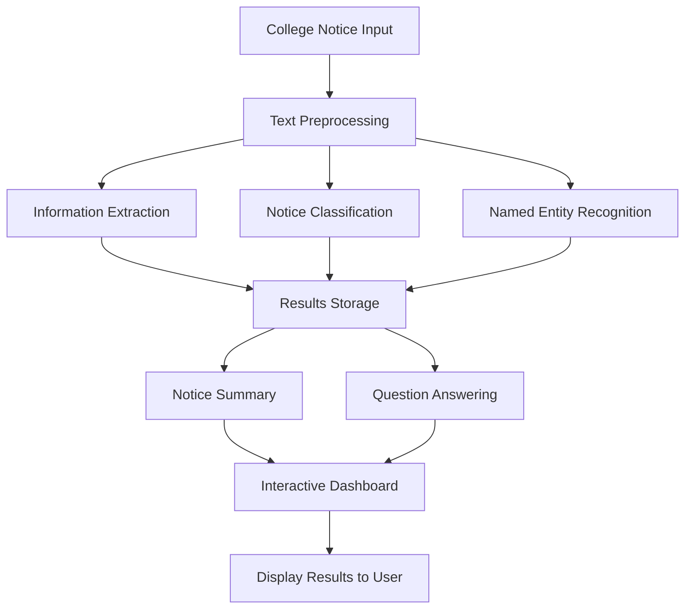

# 🎓 CollegeNoticeIQ
### College Notice Understanding System Using Natural Language Processing

CollegeNoticeIQ is an NLP-based web application that helps students understand college notices by extracting important information, classifying notices, generating summaries, identifying named entities, and answering questions about notice content.

The application provides a simple interactive dashboard where users can analyze college notices and quickly find details such as event names, dates, times, venues, deadlines, and required items.

---

## 📌 Table of Contents

- [Project Overview](#-project-overview)
- [Problem Statement](#-problem-statement)
- [Objectives](#-objectives)
- [Features](#-features)
- [Technologies Used](#-technologies-used)
- [How It Works](#-how-it-works)
- [Project Workflow](#-project-workflow)
- [Project Structure](#-project-structure)
- [Installation and Setup](#-installation-and-setup)
- [How to Use](#-how-to-use)
- [Sample Input and Output](#-sample-input-and-output)
- [NLP Techniques Used](#-nlp-techniques-used)
- [Limitations](#-limitations)
- [Future Enhancements](#-future-enhancements)
- [Project Information](#-project-information)

---

## 📖 Project Overview

College notices contain important announcements about examinations, assignments, workshops, seminars, placements, holidays, and other academic activities.

Students may need to read lengthy notices to find specific details. CollegeNoticeIQ simplifies this process by analyzing the notice and presenting its important information in a structured format.

The application uses Natural Language Processing (NLP) techniques and rule-based processing to make college notices easier to understand.

## ❗ Problem Statement

Students frequently receive college notices containing important information in paragraph form. Finding specific details such as examination dates, venues, deadlines, and required documents can take time.

A simple system is needed to automatically process college notices, extract useful information, categorize announcements, and answer common questions.

## 🎯 Objectives

- Automatically analyze college notices.
- Extract important event information.
- Classify notices into predefined categories.
- Generate basic summaries of notices.
- Identify named entities using spaCy.
- Answer common questions about notice content.
- Display results through a user-friendly web interface.

---

## ✨ Features

### 1. Notice Classification
Classifies notices into predefined categories:

- Examination
- Placement
- Workshop
- Seminar
- Assignment
- Holiday
- Event
- General

### 2. Information Extraction
Extracts relevant information from notices:

- Event name
- Date
- Time
- Venue
- Department
- Deadline
- Requirements

Extraction uses predefined regular-expression patterns and rules. Results depend on the wording of the notice.

### 3. Text Summarization
Generates a basic extractive summary by selecting the first two sentences of the notice.

### 4. Question Answering
Answers supported questions about the notice, including:

- Where is the exam?
- When is the exam?
- What should students bring?
- What is the event?
- What is the deadline?
- What type of notice is this?

### 5. Named Entity Recognition (NER)
Uses the spaCy English language model to identify entities such as dates, times, and organizations.

### 6. Text Preprocessing
Tokenizes the notice and removes common English stop words and punctuation from the displayed preprocessing output.

### 7. Interactive Dashboard
Displays the results in two compartments:

- **Notice Analysis:** Category, extracted information, and summary.
- **Ask Questions:** Question-answering interface, named entities, and preprocessed tokens.

---

## 🛠️ Technologies Used

| Technology | Purpose |
|---|---|
| Python | Application logic and text processing |
| Streamlit | Interactive web application and dashboard |
| spaCy | Tokenization, sentence segmentation, and NER |
| `en_core_web_sm` | Pre-trained English NLP pipeline |
| Regular Expressions (`re`) | Pattern-based information extraction |
| Keyword Matching | Rule-based notice classification and question routing |

---

## 🔄 How It Works

CollegeNoticeIQ processes a notice through a sequence of NLP and rule-based operations.

### Step 1: Notice Input
The user pastes a college notice into the application's text area.

### Step 2: Text Preprocessing
The application tokenizes the text and prepares a list of tokens after removing common stop words and punctuation.

### Step 3: Information Extraction
Regular expressions identify supported patterns for dates, times, venues, deadlines, requirements, and selected event names.

Department extraction also uses predefined text patterns.

### Step 4: Notice Classification
The application checks for predefined keywords to determine the notice category.

For example, words such as "exam", "practical", and "examination" can trigger the Examination category.

### Step 5: Text Summarization
The notice is divided into sentences using spaCy, and the first two sentences are selected as the summary.

### Step 6: Named Entity Recognition
The spaCy English model processes the notice to identify named entities.

### Step 7: Question Answering
The user enters a question. The application matches the question against supported patterns and retrieves an answer from the extracted information or notice text.

### Step 8: Results Display
The application displays the category, extracted information, summary, NER results, and question answers in the dashboard.

---

## 🗺️ Project Workflow



The workflow illustrates the main processing stages. In the implementation, summarization and NER are performed through spaCy, while extraction, classification, and question answering use predefined patterns and rules.

---

## 📂 Project Structure

```text
CollegeNoticeIQ/
│
├── app.py
│   └── Main Streamlit application
│
├── README.md
│   └── Project documentation
│
└── requirements.txt
    └── Python dependencies
```

Additional files, virtual environments, and screenshots can be included as the project develops.

---

## ⚙️ Installation and Setup

### Prerequisites

Install the following software:

- Python
- Visual Studio Code (recommended)
- A web browser

### 1. Open the Project

Open your CollegeNoticeIQ project folder in Visual Studio Code.

### 2. Create a Virtual Environment

Run the following command in the terminal:

```bash
python -m venv venv
```

Activate the environment on Windows:

```bash
venv\Scripts\activate
```

### 3. Install Dependencies

Create a file named `requirements.txt` containing:

```text
streamlit
spacy
```

Install the dependencies:

```bash
python -m pip install -r requirements.txt
```

### 4. Download the spaCy English Model

```bash
python -m spacy download en_core_web_sm
```

### 5. Run the Application

```bash
python -m streamlit run app.py
```

### 6. Open the Application

Open the local URL displayed in the terminal. It is usually:

`http://localhost:8501`

The CollegeNoticeIQ dashboard should appear in your browser.

---

## 🚀 How to Use

1. Open CollegeNoticeIQ in your browser.
2. Paste a college notice into the input text area.
3. Click **Analyze Notice**.
4. View the notice category and extracted information in the left compartment.
5. Read the generated summary.
6. Enter a question in the right compartment.
7. Click **Get Answer**.
8. View the answer and explore the Named Entity Recognition results.
9. Expand the preprocessing section to inspect the processed tokens.

---

## 🧪 Sample Input and Output

### Sample Notice

```text
The Machine Learning practical exam will be held on
18 October 2026 at 10 AM in Computer Lab 2.
Students must bring their journal and college ID card.
```

### Expected Output

| Field | Expected Result |
|---|---|
| Notice Category | Examination |
| Event | Machine Learning practical exam |
| Date | 18 October 2026 |
| Time | 10 AM |
| Venue | Computer Lab 2 |
| Department | Not found |
| Deadline | Not found |
| Requirements | must bring their journal and college ID card |

The department and deadline are shown as "Not found" because the sample notice does not contain matching information.

### Sample Questions and Answers

**Question:** Where is the exam?

**Answer:** The venue is Computer Lab 2.

**Question:** When is the exam?

**Answer:** The date is 18 October 2026 and the time is 10 AM.

**Question:** What should students bring?

**Answer:** must bring their journal and college ID card.

**Question:** What type of notice is this?

**Answer:** This notice is classified as: Examination.

*Note: Actual extraction results depend on the predefined patterns and the wording of the input notice.*

---

## 🧠 NLP Techniques Used

### Tokenization
Divides text into smaller units called tokens.

### Stop-Word Removal
Removes common words such as "the", "is", and "a" from the preprocessing output.

### Rule-Based Information Extraction
Uses regular expressions and text patterns to identify specific information.

### Keyword-Based Classification
Assigns a notice category by matching words against predefined keyword lists.

### Extractive Summarization
Selects existing sentences from the notice instead of generating new sentences.

### Named Entity Recognition
Uses spaCy to identify entities such as dates, times, and organizations.

### Pattern-Based Question Answering
Matches supported question types and retrieves answers using extracted information.

---

## ⚠️ Limitations

- Information extraction relies on predefined patterns and may fail on differently worded notices.
- Event extraction recognizes selected event phrases rather than every possible event.
- Notice classification is keyword-based and may not understand the complete meaning of a notice.
- Summarization selects the first two sentences instead of generating a context-aware summary.
- Question answering supports predefined question patterns rather than arbitrary questions.
- Named Entity Recognition depends on the capabilities of the spaCy English model.
- The current application is designed primarily for English notices.

---

## 🔮 Future Enhancements

- Train a machine-learning model for notice classification.
- Improve event, department, deadline, and requirement extraction.
- Implement more flexible question answering.
- Add more context-aware summarization.
- Support Marathi and other Indian languages.
- Allow users to upload PDF notices and images.
- Store previously analyzed notices in a database.
- Add search and filtering for stored notices.
- Improve responsive design for mobile devices.
- Add automated testing and evaluation of NLP accuracy.

---

## 🎓 Project Information

**Project Name:** CollegeNoticeIQ  
**Project Type:** NLP Mini Project  
**Domain:** Natural Language Processing  
**Programming Language:** Python  
**Interface:** Streamlit Web Application  

### Project Goal

To simplify college notice understanding by extracting important information, classifying announcements, summarizing content, identifying named entities, and answering common questions through an interactive application.

---

## 👩‍💻 Author

Tanisha Mhatre

---

**CollegeNoticeIQ — Making college notices easier to understand.**
